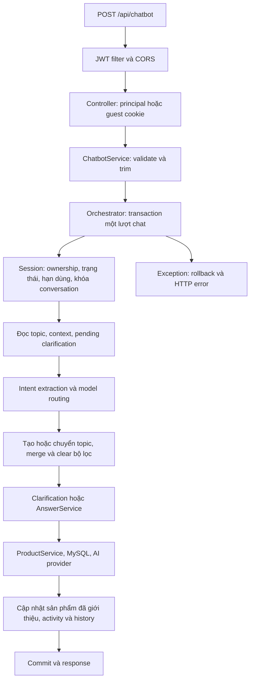

# Báo cáo audit AI Chatbot DLMStore

Ngày thực hiện: 18/10/2026. Phạm vi: backend hiện có trong workspace; không có source frontend trong workspace để kiểm tra trực tiếp. Workspace đã có nhiều thay đổi staged/unstaged trước khi audit; báo cáo chỉ nhận các sửa đổi bổ sung của đợt này.

## A. Root cause và luồng thực thi

Luồng đã kiểm tra và nối lại:



### Response fallback và conversationId null

Nguồn chính xác là `chatbot/exception/ChatbotExceptionHandler.java`, method `handleUnexpectedError` (dòng 75 tại thời điểm audit). Method tạo `new ChatBotResponse(answer, List.of())` và trả **HTTP 500**. Constructor hai tham số không gán conversationId/topicId. Vì vậy DTO lỗi có các trường ID null; hình dạng JSON này không chứng minh request đã thành công hoặc conversation chưa từng được tạo.

Test `unexpectedFailureProduces500WithOriginalFallbackShape` đã tái hiện đường đi này bằng lỗi hệ thống `IllegalStateException`: HTTP 500, products là mảng, conversationId null. Handler database hiện có thông báo riêng với HTTP 500. Handler AI trả 503 và giữ ID đã commit khi tiếp tục phiên; lỗi ownership trước đây cũng rơi vào handler 500 vì chưa có mapping riêng, hiện trả 403.

**Không có log/stack trace của chính request lỗi người dùng cung cấp**, nên chưa thể kết luận exception gốc của request đó là database, provider hay nguyên nhân khác. Không gán sai lệch schema hoặc lỗi bytecode phát hiện trong test thành nguyên nhân lịch sử khi chưa có bằng chứng.

### Các lỗi xác nhận từ code và test

| Mức độ | Phát hiện | Kết quả |
|---|---|---|
| HIGH | JWT filter tạo `CustomUserPrincipal` nhưng controller chỉ nhận `Users`, làm user thành guest | Nhận đúng principal; kiểm tra bằng JWT thật ký tại backend trong test |
| HIGH | Orchestrator không gọi topic/context/clarification, chỉ đọc activeTopicId vốn null | Đã nối tạo/chuyển topic, context và clarification vào request thực tế |
| HIGH | Các bước session/activity/history commit riêng, thiếu transaction toàn lượt | Gộp transaction; lỗi AI rollback lượt thất bại |
| HIGH | Không khóa conversation khi nhiều request cùng sửa context hoặc tạo pending | Pessimistic write lock trên conversation; test hai request đồng thời đạt |
| HIGH | CORS cho mọi origin với credentials, trong khi CSRF bị tắt | Chuyển sang allowlist origin có cấu hình; origin lạ bị từ chối |
| HIGH | AUTO dừng ngay nếu provider đầu thiếu key hoặc trả lỗi không retryable | Tiếp tục provider khác; kiểm chứng bằng mock |
| MEDIUM | Explicit model trả JSON lỗi bị coi là lỗi request 400 | Chuẩn hóa thành AiProviderException/503 ở bước intent |
| MEDIUM | RestTemplate không có timeout | Connect timeout 5 giây, read timeout 30 giây |
| MEDIUM | Ownership và conversation đóng/hết hạn trả lỗi hệ thống 500 | Lần lượt 403 và 409; exception trạng thái riêng tránh biến lỗi lập trình thành 409 |
| MEDIUM | Entity UUID String mặc định VARCHAR, DB chatbot dùng CHAR(36) | Gán JDBC CHAR cho ID/conversationId theo metadata thực tế |
| MEDIUM | History không lưu presented_products | Lưu đúng ID sản phẩm trả về |
| MEDIUM | Bản sao context chia sẻ các list có thể sửa từ bên ngoài | Sao chép list khi trả context |
| LOW | record principal có toString mặc định chứa guest token | Redact guestToken |

Lần chạy Maven đầu gặp `ClassFormatError: Invalid method Code length 0` trong `Roles` ở target. Có lần chạy incremental khác gặp bytecode chứa lỗi compiler về source level. `clean` loại bỏ các artifact lỗi và build lại thành công. Chưa xác định công cụ nào đã sinh các artifact đó; không sửa source Roles theo suy đoán.

## B. Các file được bổ sung sửa trong đợt audit

Đường dẫn Java dưới đây tương đối với `src/main/java/com/dinhluong/dlmstore/`.

| File | Vấn đề và cách sửa | Ảnh hưởng |
|---|---|---|
| chatbot/controller/ChatbotController.java | Nhận CustomUserPrincipal; cookie Secure theo HTTPS hoặc cấu hình | User không bị biến thành guest; localhost HTTP vẫn dùng được |
| chatbot/dto/ConversationPrincipal.java | Redact token trong toString | Giảm rò rỉ token khi log object |
| chatbot/service/ChatbotConversationOrchestrator.java | Transaction; nối topic/context/clarification; merge criteria; lưu ID sản phẩm | Khôi phục quản lý hội thoại nhiều lượt |
| chatbot/service/ConversationSessionService.java | Đọc session bằng khóa; exception trạng thái riêng | Chặn cập nhật đồng thời và phân loại lỗi đúng |
| chatbot/repository/ChatbotConversationRepository.java | Thêm findForUpdate với PESSIMISTIC_WRITE | Khóa theo conversation tại MySQL |
| chatbot/service/ConversationTopicService.java | Bỏ readOnly trên thao tác có gọi session lock | Tương thích khóa MySQL |
| chatbot/service/ConversationContextService.java | Transaction cho session lock; sao chép list | Giữ context tách biệt, Hibernate nhận Map mới |
| chatbot/service/ClarificationService.java | Exception trạng thái riêng, validate độ dài/hạn dùng | Không nhận clarification quá dài hoặc đã hết hạn lúc tạo |
| chatbot/service/IntentExtractionService.java | Đồng bộ minBattery > 0 và topicName tối đa 150 ký tự với service | Dữ liệu AI lỗi được phát hiện trong bước validation provider |
| chatbot/service/ChatHistoryService.java | Lưu presentedProducts | History phản ánh thẻ sản phẩm đã trả |
| chatbot/service/ChatbotProductSearchService.java | Kiểm tra lại ACTIVE sau khi tải entity | Không đưa sản phẩm vừa inactive vào dữ liệu AI/UI |
| chatbot/ai/AiRouter.java | Kiểm tra text rỗng, chuẩn hóa lỗi validation explicit model | Phân biệt dữ liệu AI lỗi với request lỗi |
| chatbot/ai/FallbackAiClient.java | Không chặn provider tiếp theo khi provider hiện tại cấu hình sai | AUTO chịu lỗi từng provider |
| chatbot/ai/AiJsonParser.java | Chỉ bắt JsonProcessingException | Không che các lỗi runtime không phải parsing |
| chatbot/exception/ChatbotExceptionHandler.java | Thêm mapping 403/409/JSON 400 | Giữ schema success và error hiện có |
| chatbot/exception/ConversationAiException.java | Giữ conversationId/topicId đã commit khi AI lỗi | Client có thể retry cùng phiên; không trả ID của dữ liệu đã rollback |
| chatbot/exception/ConversationStateException.java | Exception domain mới | Lỗi lập trình IllegalStateException vẫn là 500 |
| chatbot/entity/ChatbotConversation.java | JDBC CHAR cho id | Khớp CHAR(36) thực tế |
| chatbot/entity/ChatbotTopic.java | JDBC CHAR cho conversationId | Khớp DB |
| chatbot/entity/ChatbotClarification.java | JDBC CHAR cho conversationId | Khớp DB |
| chatbot/entity/ChatbotInteraction.java | JDBC CHAR cho conversationId | Khớp DB |
| config/AppConstants.java | Chuẩn hóa /api/chatbot có dấu / | Guest endpoint public rõ ràng |
| config/AppConfig.java | Timeout HTTP client | Provider không treo vô hạn |
| config/WebConfig.java | Allowlist origin cấu hình | Production phải khai báo domain frontend |
| security/JwtAuthenticationFilter.java | Authorization sai/hết hạn tại chatbot trả 401 | Không âm thầm downgrade token sai thành guest |
| src/test/.../chatbot/ChatbotUnitTest.java | Unit, HTTP provider giả lập, fallback, context, ownership | Không gọi AI thật |
| src/test/.../chatbot/ChatbotIntegrationTest.java | MockMvc + Spring Security + MySQL + AI mock | Kiểm tra HTTP, cookie, dữ liệu, concurrency |
| src/test/.../DlmstoreApplicationTests.java | Mock startup runners; ddl-auto=none | Test không tự seed user/rebuild sản phẩm hoặc sửa schema |

Không sửa migration đã chạy, không drop/reset bảng. Test integration dùng transaction rollback; riêng test concurrency commit một conversation có ID ngẫu nhiên rồi dọn đúng các hàng do test đó tạo trong finally. Lần chạy baseline ban đầu đã chạy startup runner có sẵn của dự án để rebuild dữ liệu dẫn xuất sản phẩm; các lần sau mock runner để tránh tác dụng phụ này.

## C. Test results

Lệnh build cuối: `./mvnw.cmd clean verify --no-transfer-progress`. Kết quả **BUILD SUCCESS**, exit code **0** lúc 22:54 ngày 18/10/2026: **35 test, 0 failure, 0 error, 0 skipped**; gồm 18 unit test, 16 integration test và 1 context test hiện có. Báo cáo Maven nằm trong `target/surefire-reports/`; log build tại `audit-final.log`. Các hạng mục chưa chạy bên dưới không được tính là test PASS.

| Test case | Expected | Actual trong test đã chạy | Kết quả |
|---|---|---|---|
| Guest token | Random, hash SHA-256, so sánh đúng | Đúng; token 43 ký tự, hash 64 ký tự | PASS |
| Guest lượt đầu và tiếp tục | Cookie HttpOnly, cùng conversation, có topic/history | Lưu MySQL; 2 lượt dùng cùng conversation | PASS |
| Cookie sai/thiếu, guest vào user conversation | 403 | 403 | PASS |
| Principal user và JWT hợp lệ | Gắn đúng userId, không guest cookie | Đúng qua filter và controller | PASS |
| User vào conversation người khác | 403 | 403 | PASS |
| Conversation CLOSED/hết hạn | 409 | 409 | PASS |
| Request blank/JSON lỗi/JWT lỗi | 400/400/401 | Đúng | PASS |
| Origin không được phép | 403 | 403 | PASS |
| Topic mới và chuyển lại | Đúng topic thuộc conversation | Đúng | PASS |
| Context qua nhiều lượt | Giữ hãng/giá, bổ sung RAM, clear hãng, đổi giá | Đúng trong MySQL | PASS |
| Clarification | Tạo pending rồi resolve, không resolve cancelled/expired | Đúng | PASS |
| Concurrency | Hai lượt, một topic, không mất history | Hai interaction, một topic | PASS |
| AI failure khi tiếp tục | 503, không thay đổi activity/history đã commit | Đúng | PASS |
| AUTO provider thiếu key | Thử provider kế tiếp | Đúng | PASS |
| Explicit model JSON lỗi | AiProviderException | Đúng | PASS |
| Provider 401/403/429/500/503 | Phân loại retryable đúng | Đúng bằng MockRestServiceServer | PASS |
| Lỗi hệ thống qua controller | HTTP 500, fallback shape hiện tại | 500, conversationId null | PASS |
| Handler lỗi database | HTTP 500, thông báo riêng | Đúng, khác thông báo lỗi hệ thống | PASS |
| AI chọn ID không có trong DB candidates | Không trả ID bịa | Chỉ trả ID candidate từ DB | PASS |
| Truy vấn sản phẩm MySQL | ACTIVE, giá từ DB, giữ hãng/ngân sách | Đúng với dữ liệu hiện có, phân biệt alternatives | PASS |
| Live AI và chất lượng hiểu 15 câu tiếng Việt | Cần provider thật | Không gọi API thật | CHƯA CHẠY |
| Frontend trên browser HTTPS/domain thật | Cần frontend/deployment | Không có trong workspace | CHƯA CHẠY |

MySQL thực tế kết nối được. AI trong integration test được mock ở router, nhưng vẫn chạy intent parsing/validation, controller, security, service, JPA và SQL thật. Các test provider dùng MockRestServiceServer; không gửi key/request tới dịch vụ ngoài. JWT test ký bằng cấu hình backend tại runtime, không in token.

## D. Chất lượng code và tính nhất quán

- Giữ các trách nhiệm session/topic/context/clarification ở service hiện có; orchestrator điều phối và không thay thế ProductService.
- Xác thực quyền sở hữu diễn ra trước khi đọc context, pending hay gọi AI. User không được tự nhận userId từ body; guest token chỉ lưu hash trong DB.
- Conversation lock kết hợp transaction ngăn hai lượt cùng tạo topic/pending và ghi đè context. Transaction bảo đảm không commit history/activity/topic rời rạc khi lượt chat thất bại.
- Success contract vẫn là ApiResponse với data.answer/products/conversationId/topicId/clarificationId/requiresClarification. Error giữ ChatBotResponse hiện có, trả mã HTTP thật. Frontend phải đọc HTTP status, không coi mọi JSON có answer là thành công.
- AI product IDs được kiểm tra với candidates từ database. Khi sinh lời tư vấn sản phẩm thất bại, hệ thống có fallback có ích từ dữ liệu DB và nói rõ AI không khả dụng; intent extraction thất bại trả 503.
- Context luôn gán Map mới để Hibernate dirty checking nhận thay đổi. Trò chuyện xã giao không xóa danh sách sản phẩm trước đó; lượt tìm kiếm rỗng cập nhật danh sách thành rỗng.

## E. Giới hạn còn tồn tại và phần chưa xác minh

1. Chưa xác định exception gốc của request lỗi ban đầu do thiếu log tương ứng. Khi tái hiện cần lưu HTTP status, thời điểm và stack trace `Lỗi không mong muốn trong chatbot`; không ghi Authorization/Cookie.
2. Transaction hiện bao gồm lời gọi AI và giữ khóa conversation trong thời gian đó. Đổi lại có tính nhất quán, nhưng hội thoại chậm sẽ chặn lượt tiếp theo và dùng connection lâu. Đã thêm timeout; khi tải cao nên tách snapshot/generate/commit với optimistic version và retry có kiểm soát, kèm migration tương thích.
3. Conversation quá hạn bị từ chối theo expiresAt; **chưa có job tự chuyển status ACTIVE thành EXPIRED trong DB**. Không thêm thao tác set EXPIRED rồi throw trong cùng transaction vì sẽ rollback.
4. Guest đăng nhập không tự nhận quyền conversation guest cũ; request dùng user principal vào guest conversation bị từ chối. **NOT IMPLEMENTED: migration/claim guest history sang user**. Chưa có API contract cho thao tác claim.
5. **NOT IMPLEMENTED: giải tham chiếu “máy thứ 2” một cách xác định trong luồng trả lời sản phẩm và phát lại đúng danh sách ID trước đó.** Context đã lưu lastProductIds, service có getProductIdByPosition, nhưng DTO intent chưa có trường vị trí/ID sản phẩm để nối trọn vẹn. AI có thể suy ra tên, không coi đó là bảo đảm chức năng.
6. Các câu Samsung/giá/RAM/pin/5G/so sánh dùng các bộ lọc đã có và context mới nối lại. Chưa chứng nhận độ chính xác NLP của các câu này bằng model thật. “Tư vấn chơi game” chưa có bộ lọc hiệu năng riêng. “Chuyển laptop” phụ thuộc OUT_OF_DOMAIN do AI nhận diện; chưa có bộ phân loại domain xác định.
7. Không thể bảo đảm LLM không bịa nội dung tự do chỉ bằng prompt. ID sản phẩm đã có allowlist; giá và tồn kho được đưa từ DB. Cần live eval để đo độ đúng của lời văn.
8. ProductService chỉ tìm ACTIVE; product mapper vẫn có thể hiển thị tồn kho bằng 0 của variant. Chưa thêm chính sách tự loại mọi sản phẩm có totalStock=0 vì chưa có quy tắc nghiệp vụ thống nhất. Chưa sửa việc mapper đọc cả variant inactive; cần xác định chính sách công khai variant trước khi thay đổi.
9. Đã đọc metadata cột chatbot và thử Hibernate schema validation; bước validate ban đầu chỉ ra CHAR/VARCHAR mismatch. Test API chạy ddl-auto=none, không tuyên bố toàn bộ schema ứng dụng đã validate hoặc kiểm chứng mọi FK/index. Cần version hóa schema/migration hiện tại trước triển khai môi trường mới.
10. Test integration cần MySQL và cấu hình backend sẵn có. Chưa dùng Testcontainers, chưa tạo database test độc lập. Chạy trên database dành cho test là bước cần làm trước CI.
11. CSRF toàn ứng dụng vẫn tắt theo thiết kế JWT hiện có. Chatbot cookie dùng SameSite=Lax và CORS allowlist để kiểm tra Origin trong browser; không tuyên bố đã audit CSRF của mọi endpoint ngoài chatbot. Cross-site frontend cần thiết kế cookie/CSRF bổ sung, không chỉ đổi SameSite=None.

## F. Hướng dẫn test thủ công / Postman

Biến môi trường Postman: `baseUrl`, `conversationId`, `topicId`, `jwt`. Dùng cookie jar tự động; không gửi userId trong body.

Cấu hình localhost (hai origin mặc định được phép):

```properties
chatbot.cookie.secure=false
app.cors.allowed-origins=http://localhost:3000,http://localhost:5173
```

Production HTTPS, đặc biệt khi TLS kết thúc tại reverse proxy:

```properties
chatbot.cookie.secure=true
app.cors.allowed-origins=https://YOUR_FRONTEND_DOMAIN
```

Allowlist áp dụng CORS toàn ứng dụng; khai báo đầy đủ domain frontend hợp lệ trước deploy. Khi gọi từ browser cần `credentials: 'include'` hoặc Axios `withCredentials: true`. Không dùng domain wildcard với cookie.

### Guest lượt đầu

```http
POST {{baseUrl}}/api/chatbot
Content-Type: application/json

{"message":"Tìm Samsung dưới 10 triệu","model":"AUTO"}
```

Mong đợi: 200 nếu AI hoạt động; Set-Cookie dlm_guest có HttpOnly, SameSite=Lax, Path=/, MaxAge=7 ngày; Secure với HTTPS. Lưu `data.conversationId` và `data.topicId`. Khi AI không khả dụng, kiểm tra status 503 thay vì chỉ đọc answer.

Postman Tests:

```javascript
if (pm.response.code === 200) {
  const data = pm.response.json().data;
  pm.environment.set('conversationId', data.conversationId);
  pm.environment.set('topicId', data.topicId);
  pm.expect(data.conversationId).to.be.a('string');
}
```

### Tiếp tục với cookie jar cũ

```http
POST {{baseUrl}}/api/chatbot
Content-Type: application/json

{"message":"Có máy RAM 8GB không?","conversationId":"{{conversationId}}","model":"AUTO"}
```

Sau đó gửi lần lượt “Bỏ điều kiện Samsung”, “Đổi ngân sách thành 15 triệu”, “Bắt đầu chủ đề mới”, “Quay lại chủ đề trước”. Mong đợi conversation không đổi, topic đổi khi cần và bộ lọc merge/clear đúng. Tách rõ hành vi model extraction với hành vi backend khi điều tra lỗi.

### User đăng nhập

```http
POST {{baseUrl}}/api/chatbot
Authorization: Bearer {{jwt}}
Content-Type: application/json

{"message":"So sánh iPhone 15 và Samsung S24","model":"AUTO"}
```

Mong đợi conversation.user_id là user đã ký JWT, guest_token_hash null; không phát guest cookie mới. Dùng JWT user khác với conversationId đó phải trả 403. JWT sai/hết hạn phải 401.

### Kiểm tra cô lập phiên và lỗi

- Xóa cookie jar rồi gửi conversationId guest cũ: 403.
- Đổi cookie guest sang giá trị khác: 403.
- Đổi model thành giá trị không thuộc enum hoặc gửi JSON lỗi: 400.
- Conversation CLOSED hoặc expires_at đã qua: 409; chỉ tạo fixture thử nghiệm, không sửa dữ liệu người dùng thật để test.
- Origin không nằm trong allowlist: 403 trong browser/MockMvc.

### SQL chỉ đọc

Thay placeholder bằng ID test; không dán token thô vào SQL/log.

```sql
SELECT id, user_id, active_topic_id, status, last_message_at, expires_at
FROM chatbot_conversations WHERE id = '<conversationId>';

SELECT id, conversation_id, topic_name, context_data, updated_at
FROM chatbot_topics WHERE conversation_id = '<conversationId>';

SELECT id, topic_id, intent, processing_status, presented_products, created_at
FROM chatbot_interactions WHERE conversation_id = '<conversationId>' ORDER BY id;

SELECT id, topic_id, status, attempts, max_attempts, expires_at, resolved_at
FROM chatbot_clarifications WHERE conversation_id = '<conversationId>';
```

Không chạy live AI mặc định trong automated test. Để chạy nhanh unit test: `./mvnw.cmd -Dtest=ChatbotUnitTest test`; khi có artifact target bất thường dùng `clean` trước.
