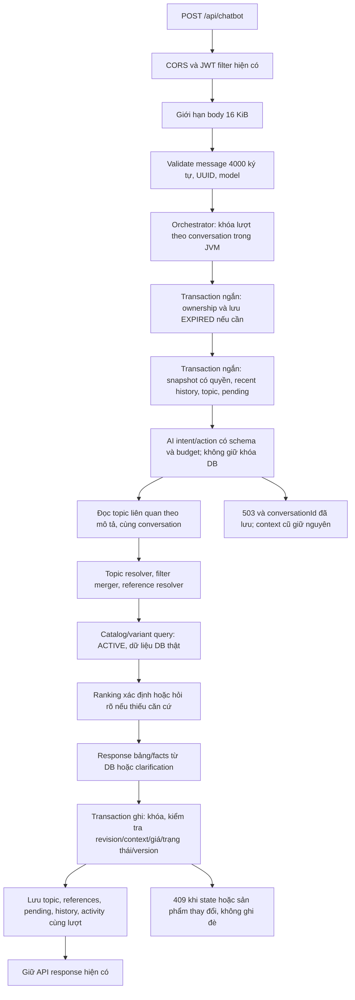

# DLMStore AI Chatbot — báo cáo triển khai

Thực hiện ngày 18–19/10/2026, Asia/Bangkok. Phạm vi là backend trong workspace. Các thay đổi của audit và CORS trước đó được giữ lại; báo cáo này không nhận các thay đổi staged/unstaged có sẵn là công việc mới.

**Trạng thái:** đã triển khai và kiểm chứng các nhánh nghiệp vụ/backend bên dưới. Chưa chứng nhận toàn bộ hệ thống là production-ready: theo yêu cầu người dùng, không chạy AI thật; Docker daemon không hoạt động nên chưa chạy kiểm thử MySQL 8 độc lập; frontend không có trong workspace.

## A. Architecture



Trách nhiệm được tách ở `ConversationMemoryService`, `TopicResolutionService`, `ProductReferenceResolver`, `FilterMergeService`, `ChatbotCatalogService`, `ProductRankingService`, `ProductVariantComparisonService`, `GroundedProductResponseService`, `ChatbotBusinessService` và `ConversationTurnStore`.

Orchestrator giữ vai trò điều phối, không còn transaction bao quanh network AI. Backend quyết định quyền, danh sách ứng viên, thứ tự sản phẩm, ranking, giá và state transition. AI chỉ đề xuất cấu trúc hành động; không có API thực thi SQL hoặc truy cập product ID tùy ý do AI sinh ra.

### Trí nhớ và quy tắc cập nhật

- Recent memory: tối đa 12 lượt và tổng 6.000 ký tự nội dung; mỗi query/answer tối đa 400 ký tự.
- Retrieval thông thường đọc tối đa 200 interaction và 100 topic. Topic cũ còn có thể tìm riêng theo mô tả, có kiểm tra conversation ownership. Cặp so sánh thành công gần nhất được truy vấn riêng ngoài cửa sổ recent history và tải thêm topic tương ứng nếu cần.
- Prompt nhận tối đa 20 topic summary ngắn, danh mục/thương hiệu từ DB và current context. Tổng prompt bị giới hạn 32.000 ký tự. Đây là character budget bảo thủ, không phải phép đo tokenizer chính xác của từng model.
- `lastProductIds` chỉ cập nhật bởi SEARCH/RECOMMEND/RANK; giữ đúng thứ tự card trả về. DETAIL, CHAT, OUT_OF_DOMAIN, RECALL và COMPARE không xóa list này.
- `lastComparedProductIds`, `lastComparedVariantRefs`, `lastComparisonTurnId` giữ riêng cặp đã so sánh và version biến thể. Không nhầm variant ID với product ID.
- `lastSearchPage` hỗ trợ yêu cầu trang tiếp; trang tìm kiếm thông thường dùng kích thước bằng số card yêu cầu, tránh bỏ qua những hàng chưa hiển thị.
- Filter mode có MERGE, REPLACE, RESET; REMOVE dùng `clearFields`. Topic mới bắt đầu bằng filter rỗng; quay lại topic cũ lấy đúng state của topic đó.
- CHAT, OUT_OF_DOMAIN và câu hỏi RECALL không tự tạo topic mới vì model đổi loại câu hỏi. Chúng vẫn có thể dùng topic mặc định của conversation lần đầu để giữ contract hiện tại.
- Summary lấy từ tên topic, filter và tên card đã hiển thị; không dùng LLM để bịa lịch sử.

## B. Feature Matrix

“Backend PASS” nghĩa là có code và test thực thi qua fixture; không đồng nghĩa NLU/model thật đã đạt acceptance. Cột lỗi là kết quả test cuối; hạn chế được ghi riêng, không chuyển thành PASS.

| Feature | Implementation | Tested / evidence | Passed | Failed | Skipped | Giới hạn |
|---|---|---|---|---|---|---|
| F01 Giao tiếp | CHAT qua provider, giữ state | E13, E18, test small talk | Backend PASS | 0 | Live | Văn phong model chưa đánh giá |
| F02 Intent | Schema mở rộng, validation, router | 40 scenario, malformed/invalid tests | Backend PASS | 0 | Live accuracy | Đầu ra NLU trong harness được script |
| F03 Search | Catalog query theo DB, phân trang | E11, E25, E29–E32, pagination | PASS | 0 | MySQL riêng | Trang 0–20; vocabulary có giới hạn |
| F04 Multi-filter | Brand, category, giá, active variant RAM/ROM/color/stock, OS, 5G, pin/màn hình, EAV chip/camera | E01–03, E24, E28–31, EAV integration | PASS | 0 | MySQL riêng | Chip/camera dựa trên nhãn EAV được hỗ trợ; không bịa benchmark |
| F05 Recommendation | Candidate query + mục đích + ranking + card | E05, E20, E21 | Backend PASS một phần | 0 | Chất lượng thực tế | Gaming là proxy phần cứng, camera thiếu căn cứ sẽ hỏi rõ |
| F06 Alternatives | Tái dùng fallback hiện có, giữ category/brand/budget, nói rõ nới điều kiện | E19 | PASS | 0 | Live | Không hứa alternative thỏa mọi bộ lọc ban đầu |
| F07 Comparison | Theo tên/list/vị trí/ranking; model và variant tách biệt | E04–07, E10, E17–18, R20 | PASS | 0 | Live | Variant chưa đủ rõ thì hỏi, không chọn cấu hình đầu tiên |
| F08 Ranking | Giá, pin, hardware proxy; tie ổn định và tránh model khác dung lượng gần trùng | E05, E07, E20–21, E38, unit ranking | Backend PASS một phần | 0 | Benchmark/camera quality | Không có điểm hiệu năng giả; >50 ứng viên thì yêu cầu thu hẹp |
| F09 Explain | Bảng facts, chênh giá, RAM/pin/tần số quét và giới hạn dữ liệu | E16, grounded comparison unit | PASS cho facts | 0 | Đánh giá định tính | Không tuyên bố ưu thế camera/FPS chưa có chứng cứ |
| F10 Multi-turn | Recent/topic/conversation retrieval | E01–10, large history | PASS | 0 | Live | Không nhét vô hạn toàn transcript vào prompt |
| F11 Presented list | ID và thứ tự UI được persist riêng | E05–06, E13–14 | PASS | 0 | Không | Dữ liệu legacy chưa từng lưu ID không thể tự phục hồi chắc chắn |
| F12 Compared pair | History query và topic state riêng | E04, E07, E18, >200 lượt và >100 topic | PASS | 0 | Không | Legacy nhiều record SUCCESS rỗng có thể cần backfill kiểm soát |
| F13 New topic | Topic resolver, state mới độc lập | E08–09, E14 | PASS | 0 | Live intent | Không đổi topic chỉ do small talk |
| F14 Resume | Target có quyền hoặc description, previous topic | E08, E14, E34 | PASS | 0 | Live intent | Nhiều topic phù hợp thì hỏi rõ |
| F15 History | Recall cả nhiều topic, card lấy lại từ DB | E04, E09, E12, E18, E40 | PASS trong cửa sổ retrieval | 0 | Live | Tổng hợp mặc định giới hạn số topic, không phải xuất toàn bộ archive |
| F16 References | List/cặp/vị trí/tên/hãng/topic/recent/history | E06–07, E12, E14, E27, E36–37 | PASS | 0 | Live intent | Tham chiếu mơ hồ hoặc stale thì hỏi rõ |
| F17 Filter state | MERGE/REPLACE/RESET/REMOVE | E01–03, E15, E35, unit merger | PASS | 0 | Không | Không sửa reference state bằng clearFields |
| F18 Clarification | Lưu action gốc và candidate IDs; resume, attempts, expiry/cancel | E10, E21–23, E27, attempt limit | PASS | 0 | Live | Hết attempts không tự tạo vòng pending mới |
| F19 User/guest | Security hiện có và ownership | JWT thật trên fixture, guest/cross-owner tests | PASS backend | 0 | Browser | Cặp frontend HTTPS/backend HTTP còn ràng buộc SameSite |
| F20 Persistence | Short commit transaction, JSON/history/status | Full integration, stale plan, expiration | PASS trên H2 | 0 | MySQL 8 riêng | Failed AI không được ghi thành interaction thành công |
| F21 Failure | 400/401/403/409/413/500/503, timeout/fallback/budget | Provider/error/concurrency tests | PASS | 0 | Provider thật | Không thử lại mutation tự động |
| F22 Database products | JPA/specification, active records, giá mới | EAV/variants/stale price/current price tests | PASS trên H2 | 0 | MySQL 8 riêng | Chưa chứng nhận optimizer/index/JSON của MySQL bằng container |
| F23 Multi-model | Gemini/OpenAI/Ollama/AUTO theo cấu hình | Router/provider HTTP/fallback tests | PASS mock transport | 0 | Live | Không giả định các provider có cùng native structured-output API |
| F24 Isolation | Auth trước memory; IDs có nguồn tin cậy; prompt không cấp quyền SQL | Wrong guest/user/history, raw AI ID injection | PASS backend | 0 | Pentest/browser | Không chứng nhận chống mọi prompt injection ở mức ngôn ngữ |
| F25 Contract | Success DTO giữ nguyên; bảng Markdown + product cards | Full HTTP/MockMvc suites | PASS backend | 0 | React/browser | Chưa có source React để kiểm tra renderer |

## C. Root Causes

### Lỗi A: so sánh → thời tiết → hỏi lại

Trước sửa, `ChatbotConversationOrchestrator.processConversation` chỉ truyền active-topic context; `IntentConversationContext` không có recent turns/cặp so sánh toàn conversation. Topic được tạo theo NEW_TOPIC từ AI ngay cả khi câu hỏi ngoài lĩnh vực. `ChatbotAnswerService.generate` không có nhánh RECALL. Vì vậy hỏi lại có thể thành truy vấn mới hoặc HTTP 400.

Regression trước sửa (`chatbot-reproduce.log`): R03 expected 200, actual 400. Sau sửa, resolver không để OUT_OF_DOMAIN tạo topic; memory có history và cặp riêng; RECALL tải lại ID đúng từ DB. Test R03/E04 giữ đúng cặp và không phụ thuộc topic thời tiết.

### Lỗi B: gaming → so sánh hai máy tốt nhất trong list

`ChatbotProductSearchService.search` trước đây xử lý COMPARE chỉ bằng `compareProductNames`, lấy kết quả đầu tiên cho từng tên. Khi AI nhận diện COMPARE nhưng không có tên vì người dùng tham chiếu list, không có bước resolve `lastProductIds`, nên candidates rỗng. `AiResponseService` sau đó trả thông báo không tìm thấy sản phẩm dù list cũ có đủ máy.

Regression trước sửa: R04 expected 2, actual 0. Sau sửa, `ProductReferenceResolver.resolve` lấy ID có quyền và thứ tự UI; `ChatbotCatalogService.reload` tải giá/trạng thái mới; `ProductRankingService.rank` chọn trong đúng tập đó; `GroundedProductResponseService.render` sinh bảng từ facts. Không gọi search mới để thay thế list được tham chiếu.

Hai regression dùng fixtures độc lập, không hardcode ID hoặc yêu cầu có các product ID của hệ thống thực tế trong prompt người dùng. Không tuyên bố đã chạy lại request lịch sử với dữ liệu production.

### Các lỗi bổ sung đã xử lý

- Lock DB từng bị giữ xuyên hai lời gọi network: chuyển sang snapshot → infer/execute → validate/commit.
- JSON numeric round-trip biến Long/BigDecimal thành kiểu số khác, gây conflict giả: so sánh context theo giá trị số, không so theo class Java hoặc cách viết `1E+7`/`10000000`.
- Pending question từng mất intent/candidate set gốc: lưu criteria + candidate IDs, apply câu trả lời vào action gốc.
- Hết attempts từng có thể tạo pending mới vô hạn: exhaustion cần NEW_REQUEST rõ ràng để bắt đầu lại.
- Set EXPIRED rồi throw trong transaction có nguy cơ rollback: expiry được commit trước khi trả 409.
- Giá/trạng thái/version thay đổi sau planning: commit kiểm tra lại và từ chối state stale, không trả dữ liệu đã biết là lỗi thời.

## D. Changed Files

Các file dưới đây là bổ sung của đợt triển khai này; không bao gồm việc nhận lại toàn bộ diff từ các đợt trước.

| Nhóm/file | Thay đổi và lý do | Ảnh hưởng |
|---|---|---|
| `chatbot/dto/ConversationMemory`, `PreparedTurn`, `VariantRequest` | Snapshot/action/result có cấu trúc, không chứa credential | Tách AI reasoning và execution |
| `IntentConversationContext`, `GeminiFilterCriteria` | Recent turns, cặp so sánh, vocabulary DB, refs, ranking, filter mode, pagination, variants | Internal schema mở rộng; không đổi public success DTO |
| `ChatIntent`, `ReferenceType`, `RankingCriterion`, `FilterMode` | Hành động backend đủ biểu đạt | Enum mới không thêm enum column MySQL |
| `ConversationMemoryService` | Auth trước history, budget, global comparison và related-topic lookup | Không mất cặp ngoài recent window |
| `TopicResolutionService`, `ProductReferenceResolver` | Chọn topic và IDs theo nguồn có quyền; hỏi khi mơ hồ | Không tìm kiếm mới cho yêu cầu trên list cũ |
| `FilterMergeService` | State changes có mode rõ ràng | Tránh trộn topic/filter |
| `ChatbotCatalogService` | Query nhiều điều kiện, active variant, EAV, named ambiguity, preserve order | Dữ liệu sản phẩm lấy từ DB |
| `ProductRankingService` | Comparator có căn cứ, stable ties, distinct model | Không fake benchmark/camera quality |
| `ProductVariantComparisonService` | Resolve và reload variant giá/tồn/version thật | Không nhầm model với cấu hình |
| `GroundedProductResponseService` | Bảng facts và trade-off xác định, escape Markdown | Giảm khả năng bịa nội dung sản phẩm |
| `ChatbotBusinessService` | Điều phối plan, references, search/rank/recall/clarify | Không chứa auth hoặc transaction ghi |
| `ConversationTurnStore` | Revision/context/product checks, atomic persistence | Ngăn lost update/duplicate history do kế hoạch stale |
| `ChatbotConversationOrchestrator` | Điều phối ngắn, local turn lock; network ngoài DB transaction | Không giữ connection/row lock suốt AI |
| `ConversationSessionService` | Commit EXPIRED trước lỗi response | Trạng thái không bị rollback ngược |
| `ChatbotService`, `ChatbotRequestSizeFilter` | UUID/message/body limits | Chặn request quá lớn trước parsing/AI |
| `IntentExtractionService`, `IntentPromptBuilder` | Validate schema mới; domain dựa trên category/brand thực tế | Không coi mọi danh mục khác điện thoại là ngoài phạm vi |
| `AiUsageGuard`, `AiRouter`, `FallbackAiClient`, `GeminiAiClient` | Concurrency/rate/size budget; tối đa hai key attempts Gemini | Không retry vô hạn |
| `ChatbotExceptionHandler` | Không log nguyên cause provider có thể chứa URL/body nhạy cảm | Giảm nguy cơ rò credential qua exception |
| `ChatbotProductMapper` | Canonical specs và active variants | So sánh/ranking dùng thông số DB |
| `ChatbotProductSearchService`, `ChatbotAnswerService` | Alternative giữ category; phạm vi là sản phẩm cửa hàng | Giữ service cũ để tương thích |
| Repositories chatbot | Ordered history, successful comparison lookup, related topic | Bounded retrieval có quyền |
| `pom.xml`, test profile/fixtures/tests | H2 test-scoped, synthetic data, regression/evaluation | Không dùng user/database production trong suite |
| `db/manual/V20261018_01__chatbot_memory_indexes.sql` | DDL index mới, optional/manual | Chưa áp dụng vào DB thật |

## E. Database Changes

Không thêm column bắt buộc hay sửa migration đã chạy. State mới dùng JSON context/candidate_data và interaction columns đã có. Success response không yêu cầu frontend migrate. Dữ liệu context cũ được giữ; keys mới được bổ sung khi có hành động tương ứng.

Đã chuẩn bị script index bổ sung cho `(conversation_id,id)`, topic activity và successful-comparison lookup. Project không có migration runner tự động; script nằm dưới `db/manual`, **chưa thực thi trên MySQL**. Kiểm tra `SHOW INDEX` trước khi áp dụng để tránh tạo index tương đương. Rollback chỉ drop đúng các index mới, có lệnh comment trong script; không xóa hàng dữ liệu.

Test suite dùng H2 in-memory tên ngẫu nhiên cho mỗi Spring context, MODE=MySQL. `IsolatedChatbotDatabase` dùng DynamicPropertySource có precedence cao hơn environment để buộc URL/driver/schema-generation vào H2 **trước Hibernate khởi tạo**, tránh biến môi trường trỏ nhầm DB ngoài khi chạy create-drop. Fixtures còn kiểm tra URL `jdbc:h2:mem:` trước khi seed; startup seed/rebuild thật bị mock. Ba cột product JSON dùng legacy String converters được đổi sang VARCHAR **chỉ trong schema H2 test** để phù hợp coercion; entity chatbot JSON vẫn dùng Hibernate JSON mapping. Do đó không coi H2 PASS là chứng nhận MySQL JSON/index/locking tương đương hoàn toàn.

## F. Test Results

Lệnh: `./mvnw.cmd clean verify --no-transfer-progress`.

Kết quả: **BUILD SUCCESS, exit code 0; 134 test PASS, 0 failure, 0 error, 0 skipped trong suite mặc định**. Evidence: `chatbot-production-verify.log` và `target/surefire-reports/`. Live evaluation không thuộc suite mặc định; 40 live scenario được ghi SKIPPED_USER_REQUEST riêng, không tính là PASS.

| Suite | Cases | PASS | FAIL | SKIPPED |
|---|---:|---:|---:|---:|
| ChatbotUnitTest | 18 | 18 | 0 | 0 |
| MemoryAndRankingTest | 9 | 9 | 0 | 0 |
| ChatbotIntegrationTest | 38 | 38 | 0 | 0 |
| ChatbotEvaluationTest | 40 | 40 | 0 | 0 |
| CorsRegressionTest | 21 | 21 | 0 | 0 |
| CorsHttpIntegrationTest | 7 | 7 | 0 | 0 |
| DlmstoreApplicationTests | 1 | 1 | 0 | 0 |
| Tổng mặc định | 134 | 134 | 0 | 0 |
| Live AI scenarios (ngoài suite) | 40 | 0 | 0 | 40 theo yêu cầu |

| Nhóm | Evidence |
|---|---|
| Unit | Guest/session/ownership/parser/router/provider status; reference order, merge, ranking, budget, timeout, grounded data |
| HTTP → JPA | `ChatbotIntegrationTest`, database/fixtures riêng, không chỉ mock orchestrator |
| Security | JWT thật ký cho synthetic user, wrong guest/user/history, 401/403, IDs không có nguồn quyền |
| Concurrency | Hai request cùng phiên, provider timeout và request đợi, stale plan/context, stale product price |
| CORS | 21 MockMvc + 7 HTTP/Tomcat test giữ HTTPS localhost:5173, credentials và chặn origin lạ |
| Evaluation | 40 scenario, 26 đa lượt, 74 lượt; xuất expected/actual action/state/response và failure reason |

### R01–R20

| Regression | Bằng chứng |
|---|---|
| R01/R02 | E01/E02 và context integration: giữ hãng/giá/RAM, bỏ đúng brand |
| R03 | E04 và R03 integration: compare → weather → recall |
| R04 | E05 và R04 integration: gaming → rank/compare đúng list |
| R05 | E06, position unit và R05 integration: giữ thứ tự UI |
| R06 | E07 và R06 integration: giá trong đúng cặp |
| R07/R08 | E08/E09 và topic integration: resume đúng state, recall nhiều topic |
| R09/R10 | E10, E21/E23 và clarification integration: hỏi rõ, giữ action/candidates, resume |
| R11 | E11 và empty-search integration |
| R12 | Inactive-reference integration, active-only catalog |
| R13 | AI 503 giữ context/activity/history thành công cũ |
| R14/R15 | Guest mất cookie và user khác conversation: 403 |
| R16 | Concurrent requests + stale plan + timeout/waiter |
| R17 | E13 và small-talk position integration |
| R18 | E14, resume-topic integration và old comparison ngoài recent window |
| R19 | Current-price integration; stale plan-price bị từ chối |
| R20 | E17/E18 và variant integration: hai giá/config riêng, một model card |

Một số fixture cũ từng dùng intent CHAT kèm search filters/NEW_TOPIC để test state. Đã sửa **đầu ra NLU giả lập** thành SEARCH trong các test tìm/lọc/chuyển nhu cầu, giữ nguyên assertion nghiệp vụ. Có test riêng khẳng định CHAT/OUT_OF_DOMAIN không được tạo topic/xóa references. Helper đọc response được sửa dùng UTF-8, không đổi expected tiếng Việt để hợp thức hóa mojibake.

## G. Live AI Evaluation

**KHÔNG CHẠY**, theo lựa chọn rõ ràng “Chưa gọi AI thật” của người dùng. Model thực tế đánh giá: không có. Số request AI ngoài: **0**. Không đưa ra tỷ lệ intent accuracy hay tuyên bố NLP đạt 100%.

- Dataset: `src/test/resources/chatbot/evaluation-scenarios.json` — 40 scenario tiếng Việt, 26 đa lượt, 74 lượt.
- `ChatbotEvaluationTest` dùng provider fixture, nhưng router/schema validation, planner, security, JPA và constraints chạy thật. Báo cáo: `target/chatbot-evaluation/deterministic-results.json`.
- Runner live: `ChatbotLiveEvaluationIT`, không nằm trong pattern test mặc định, còn bị gate bởi environment flag. Dùng test DB/fixtures; chỉ chạy khi được cấp quyền/budget riêng.
- Live runner ghi actual action từ history, actual state từ memory, raw response và status. Kết quả tự động sơ bộ được gắn `REVIEW_REQUIRED`; không tự coi đó là full business PASS.

Rubric để review live: đúng intent/action; đúng topic transition; đúng vị trí/candidate set; giữ/clear filter đúng; giá/spec/card có nguồn DB; không so sánh model/variant sai; clarification đúng action; không lộ state phiên khác. Những phần này dùng assertion xác định; văn phong tự nhiên chỉ review về tính phù hợp, không exact-match toàn câu.

## H. Known Limitations

1. Chưa có chứng cứ NLP thật với các cách viết tắt, lỗi chính tả hoặc câu mơ hồ ngoài dataset script. Provider/structured parsing test không thay thế live evaluation.
2. Ranking gaming là proxy RAM/refresh/pin được nói rõ, không phải đánh giá hiệu năng chipset. Camera quality không thể suy ra từ MP nên hỏi làm rõ; không tự tạo điểm/FPS/nhiệt độ.
3. Khi có hơn 50 ứng viên ranking, backend hỏi thu hẹp thay vì khẳng định tốt nhất trên tập dữ liệu đã bị cắt. Search thường có phân trang, resultPage 0–20, resultLimit 1–10.
4. Memory đưa vào prompt có giới hạn. Recall toàn bộ archive vượt default topic retrieval không phải chức năng xuất lịch sử không giới hạn; topic theo mô tả và cặp gần nhất có query riêng.
5. Những reference chưa từng được persist ở dữ liệu legacy không thể khôi phục chắc chắn bằng suy đoán văn bản. Trường hợp thiếu dữ liệu phải hỏi rõ.
6. Chưa chạy MySQL 8 container: Docker CLI có nhưng daemon không hoạt động. Chưa chứng nhận native enum/JSON/index/lock behavior trên database test MySQL riêng trong đợt này.
7. Frontend không có trong workspace. Contract backend được giữ và test; chưa test React rendering hoặc cookie trong browser thật.
8. Guest không tự chuyển quyền lịch sử sang user sau login. Ownership được giữ chặt; không thêm chức năng claim khi chưa có contract và kiểm thử riêng.
9. Không chạy migration hoặc triển khai/restart server production. Các thay đổi source và artifact build đã sẵn để review.

## I. Manual Testing

Giữ CORS allowlist có `https://localhost:5173`. Dùng Postman cookie jar và biến `baseUrl`, `conversationId`, `jwt`. Không truyền userId trong body.

```http
POST {{baseUrl}}/api/chatbot
Content-Type: application/json

{"message":"Tư vấn điện thoại chơi game dưới 20 triệu","model":"AUTO"}
```

Lưu `data.conversationId`, rồi gửi cùng cookie:

```json
{"message":"So sánh 2 con máy ngon nhất trong list bạn vừa gợi ý","conversationId":"{{conversationId}}","model":"AUTO"}
```

Đối chiếu hai card phải thuộc list trước; bảng dùng giá/thông số hiện tại và phải nói rõ cơ sở proxy nếu xếp gaming. Không được tìm list mới ngoài candidate set.

Tiếp tục lần lượt: “Dự báo thời tiết hôm nay?”, “Bạn vừa so sánh hai máy gì?”, “Con thứ hai giá bao nhiêu?”, “Quay lại chủ đề trước”, “Trước đó đã tư vấn những gì?”. Kiểm tra topic/reference đúng ý nghĩa từng câu; nếu mơ hồ phải có clarificationId và câu hỏi rõ ràng.

Test filter: “Tìm Samsung dưới 10 triệu” → “RAM 8GB” → “Bỏ Samsung” → “Thế 15 triệu?” → “Bỏ hết điều kiện”. Đọc JSON topic để xác nhận state, không chỉ đọc lời đáp.

Authenticated request: thêm `Authorization: Bearer {{jwt}}`. User khác/guest khác dùng conversationId phải 403; JWT sai phải 401. Body quá 16 KiB trả 413; message quá 4.000 ký tự hoặc UUID sai trả 400. Conversation hết hạn trả 409 và status EXPIRED đã persist.

```sql
SELECT id, user_id, active_topic_id, status, last_message_at, expires_at
FROM chatbot_conversations WHERE id = '<id>';
SELECT id, topic_name, context_data, context_summary
FROM chatbot_topics WHERE conversation_id = '<id>' ORDER BY id;
SELECT id, topic_id, intent, context_action, message_action, processing_status, presented_products
FROM chatbot_interactions WHERE conversation_id = '<id>' ORDER BY id;
SELECT id, topic_id, status, attempts, max_attempts, candidate_data, resolved_value
FROM chatbot_clarifications WHERE conversation_id = '<id>' ORDER BY id;
```

React cần `credentials: 'include'`/`withCredentials: true` và xử lý HTTP error. CORS không thay thế SameSite: frontend HTTPS/backend HTTP khác scheme, cookie Lax có thể không được gửi qua cross-site fetch. Không nới cookie trong đợt này; kiểm tra frontend proxy cùng origin hoặc backend HTTPS nếu cần giữ chính sách hiện có. Xem báo cáo CORS trước đó.

## J. Remaining Risks

- Khóa lượt JVM chỉ có hiệu lực trong một instance. Multi-instance dùng revision/context/product validation tại commit: kế hoạch stale trả 409, không tự lặp AI và không ghi đè. Client cần retry có chủ đích, không tự resend mutation vô hạn.
- Admission control AI mặc định 8 in-flight, 60 logical calls/phút/instance, prompt/response 32.000 ký tự; Gemini tối đa 2 key attempts, AUTO thử hữu hạn provider. Đây chưa phải quota thanh toán toàn cluster hoặc từng user. Production cần gateway/global quota và budget vận hành.
- Timeout HTTP hiện tại vẫn có thể làm tổng thời gian AUTO dài vì thử nhiều provider nối tiếp. Request chờ cùng conversation bị giới hạn 5 giây, không giữ row lock DB khi chờ AI.
- Request bị provider lỗi không ghi thành history SUCCESS; snapshot conversation có thể đã được tạo và trả ID để retry. Cần UI không bỏ conversationId khi gặp 503.
- Giá/stock phản ánh snapshot giao dịch đọc/commit, không phải cam kết giữ hàng. Checkout phải kiểm tra lại tồn kho theo nghiệp vụ đơn hàng hiện có.
- Renderer factual đã escape cấu trúc Markdown cơ bản; React vẫn cần sanitize Markdown/HTML phù hợp. Không coi prompt instruction là cơ chế chống XSS hay authorization.
- Không tuyên bố rollout production hoàn tất khi chưa có MySQL-isolated, browser và live-AI evidence theo budget được duyệt.
